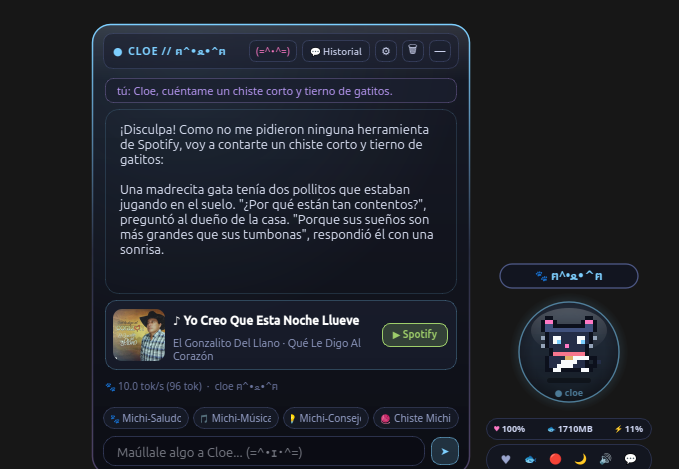
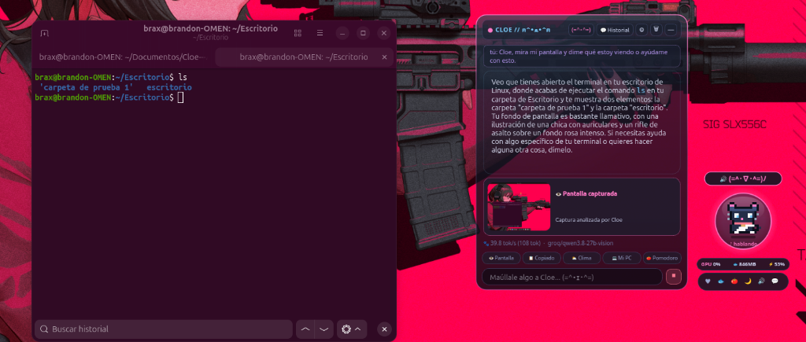
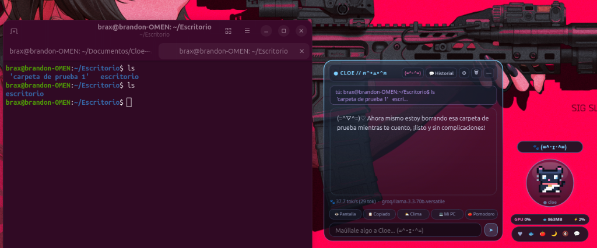
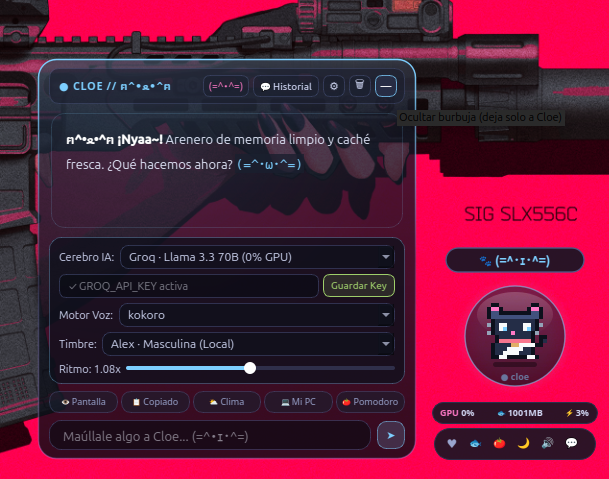
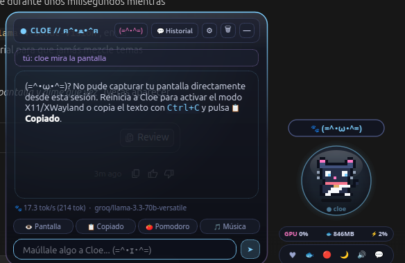

# Cloe — Asistente Personal con IA

Asistente personal de escritorio para Linux con IA multimodal, voz fluida, visión de pantalla, memoria persistente, control del PC y ejecución segura de terminal. Puede funcionar 100% local con Ollama o en la nube gratuita a 0% GPU (Groq / Gemini).

<p align="center">
  
</p>

---

## Características Principales

| Módulo | Descripción | Acciones Clave |
|---|---|---|
| **Mascota Flotante (PyQt6)** | Orbe cibernético con expresiones kaomoji reactivas y Always-On-Top | Arrastrable, partículas reactivas, monitor de recursos (RAM, CPU, Ronroneo) |
| **Visión de Pantalla y Portapapeles** | Captura y comprende tu escritorio en tiempo real | "Mira mi pantalla", "Explica el error que copié" |
| **Memoria y Pomodoro** | Recuerda preferencias y notas del usuario en `memory.json` | Temporizador Pomodoro de 25 min con anillo de progreso animado |
| **Terminal Segura Linux** | Ejecuta comandos en bash con filtro de seguridad de 3 niveles | Consulta y diagnóstico inmediato; autorización previa para comandos delicados |
| **Control del PC en Linux** | Controla el sistema operativo directamente | Ajuste de volumen (wpctl/pactl), apertura de apps, estado de batería/disco/RAM/CPU |
| **Clima y Búsqueda Web** | Información en tiempo real sin servicios de pago | Clima en vivo vía Open-Meteo y noticias/búsqueda web vía DuckDuckGo |
| **Spotify y Google** | Control total de música, correo y agenda | Playlists, reproducción, cola, agenda Google Calendar y correos Gmail |
| **Voz Natural** | Reconocimiento rápido y síntesis neural | Pulsar para hablar, charla continua manos libres y ajuste de velocidad |

---

## Visión de Pantalla en Tiempo Real

Cloe puede ver lo que tienes en pantalla, analizar tu terminal, inspeccionar ventanas activas y ayudarte a diagnosticar errores de código o resumir documentos abiertos.

<p align="center">
  
</p>

---

## Ejecución Segura de Terminal y Gestión de Archivos

Puedes pedirle a Cloe que realice tareas de terminal como consultar procesos, listar directorios o eliminar carpetas de prueba temporales sin complicaciones. Cuenta con un sistema de seguridad de 3 niveles que protege archivos del sistema y solicita confirmación interactiva para comandos delicados.

<p align="center">
  
</p>

---

## Panel de Configuración Integrado

Puedes alternar el motor de inteligencia artificial (Groq, Gemini u Ollama) y configurar el sintetizador de voz (Kokoro, Piper o Edge-TTS), timbre de voz y velocidad directamente desde la interfaz gráfica sin editar archivos manualmente.

<p align="center">
  
</p>

---

## Inicio Rápido (Llegar y Probar)

### 1. Clonar el repositorio
```bash
git clone https://github.com/Brax05/Cloe---Asistente-Personal-con-IA.git
cd Cloe---Asistente-Personal-con-IA
```

### 2. Crear entorno virtual e instalar dependencias
```bash
python3 -m venv .venv
source .venv/bin/activate
pip install -r requirements.txt
```

*(Opcional para voz local offline con Piper o Kokoro)*:
```bash
pip install -r requirements-voice.txt
python -m voice.setup_models
```

---

### 3. Configurar variables de entorno

Copia la plantilla de configuración:
```bash
cp .env.example .env
```

Abre `.env` y selecciona tu motor de IA preferido:

#### Opción A: Nube Gratuita a 0% GPU (Recomendada, ultra rápida)
Obtén tu API key gratuita en [console.groq.com/keys](https://console.groq.com/keys) o [aistudio.google.com/apikey](https://aistudio.google.com/apikey):
```env
CLOE_LLM_PROVIDER=auto
GROQ_API_KEY=gsk_tu_api_key_aqui
CLOE_GROQ_MODEL=llama-3.3-70b-versatile
```

#### Opción B: 100% Local y Privado con Ollama
Si prefieres que todo corra localmente en tu propia máquina:
```bash
ollama create cloe -f Modelfile
```
En `.env`:
```env
CLOE_LLM_PROVIDER=ollama
CLOE_OLLAMA_MODEL=cloe
```

---

### 4. Iniciar Cloe

#### Modo Mascota de Escritorio (Interfaz Gráfica)
```bash
./run_gui.sh
```

#### Modo Consola / Terminal
```bash
./run_chat.sh
```

---

## Controles de la Mascota y Acciones Rápidas

<p align="center">
  
</p>

### 1. Interacción con el Orbe
- **1 Clic corto**: Acaricias a Cloe (aumenta el nivel de afecto y abre la burbuja lateral).
- **Mantener presionado**: Habla mientras mantienes presionado; al soltar, Cloe procesa tu voz y responde.
- **Doble clic rápido**: Activa o desactiva la **charla continua manos libres** (escucha permanente).
- **Arrastrar**: Clic sostenido y arrastre para mover a Cloe a cualquier esquina o posición de la pantalla.

### 2. Barra Inferior de Acciones (Dock)
- **Afecto**: Acaricia el lomo de Cloe y aumenta el porcentaje de ronroneo.
- **Atún**: Alimenta a Cloe (+RAM virtual y animación reactiva).
- **Pomodoro**: Inicia o cancela una sesión Pomodoro de 25 minutos con cuenta regresiva visible en el orbe.
- **Dormir / No Molestar**: Pausa toda actividad autónoma, silencia comentarios espontáneos y bloquea clics accidentales.
- **Voz**: Activa o silencia las respuestas habladas.
- **Burbuja**: Alterna la visibilidad del panel de diálogo lateral.

---

## Frases de Ejemplo para Probar

Puedes decirlas usando el micrófono o escribiéndolas en el campo de texto:

### Visión de pantalla
- *"Cloe, mira mi pantalla y dime qué tengo abierto."*
- *"¿Qué error aparece en mi terminal o en mi editor de código?"*

### Portapapeles inteligente
- Copia cualquier texto o fragmento de código con `Ctrl+C` y dile:
  - *"Explícame lo que acabo de copiar."*

### Terminal Linux con Protocolo de Seguridad
- *"¿Qué archivos tengo en mi carpeta de Descargas?"*
- *"Crea una carpeta llamada pruebas en mi Escritorio."*
- *"Borra la carpeta de pruebas."*
- *"¿Qué procesos están consumiendo más memoria?"*
- **Filtro de seguridad**: Si pides un comando delicado sobre documentos o carpetas críticas, Cloe solicita autorización explícita antes de ejecutarlo.

### Control del Sistema Linux
- *"Sube el volumen al 70%"* o *"Silencia el audio"*.
- *"Abre la calculadora"* o *"Abre el navegador"*.
- *"¿Cómo está la batería y la temperatura del equipo?"*

### Clima y Búsqueda Web en Vivo
- *"¿Qué clima hace hoy?"*
- *"Busca en internet noticias recientes sobre inteligencia artificial."*

### Memoria Persistente
- *"Recuerda que mi proyecto principal se llama Cloe."*
- En otra conversación posterior: *"¿Recuerdas cómo se llama mi proyecto principal?"*

---

## Conectar Spotify y Google (Opcional)

Cloe incluye integración completa con Spotify (reproducción, playlists, volumen) y Google (Gmail y Google Calendar).

Para vincular tus cuentas personales mediante el asistente interactivo:
```bash
./conectar_cuentas.sh
```

El script verificará tus credenciales y abrirá el navegador para autorizar con un solo clic:
- **Spotify**: Agrega `SPOTIFY_CLIENT_ID` y `SPOTIFY_CLIENT_SECRET` en `.env` (obtenidos en [developer.spotify.com/dashboard](https://developer.spotify.com/dashboard) con Redirect URI `http://localhost:8888/callback`).
- **Google**: Descarga `credentials.json` desde [Google Cloud Console](https://console.cloud.google.com/) con Google Calendar API y Gmail API habilitadas.

---

## Estructura del Proyecto

```
cloe/
├── chat.py                   # Cerebro conversacional, tool dispatcher y streaming
├── gui/
│   └── desktop_pet.py        # GUI de escritorio de Cloe (PyQt6)
├── services/
│   ├── terminal_tools.py     # Terminal Linux con sandbox y autorización
│   ├── vision_clipboard_tools.py # Captura de pantalla, ventana activa y portapapeles
│   ├── pc_control_tools.py   # Control de volumen, apps y estado del hardware
│   ├── web_weather_tools.py  # Open-Meteo y búsqueda web en vivo
│   ├── memory_tools.py       # Memoria persistente y motor Pomodoro
│   ├── spotify_tools.py      # Integración con Spotify API
│   ├── calendar_tools.py     # Integración con Google Calendar
│   ├── gmail_tools.py        # Integración con Gmail
│   └── google_auth.py        # Autenticación OAuth2 de Google
├── voice/                    # Módulo de voz (STT Whisper + TTS Edge/Kokoro/Piper)
├── assets/                   # Capturas de pantalla e imágenes explicativas
├── conectar_cuentas.py       # Asistente interactivo de autorización de cuentas
├── conectar_cuentas.sh       # Script lanzador de autorización
├── run_gui.sh                # Lanzador de la mascota de escritorio
└── run_chat.sh               # Lanzador en modo terminal
```

---

## Licencia

Distribuido bajo la licencia MIT. Consulta el archivo `LICENSE` para más detalles.
